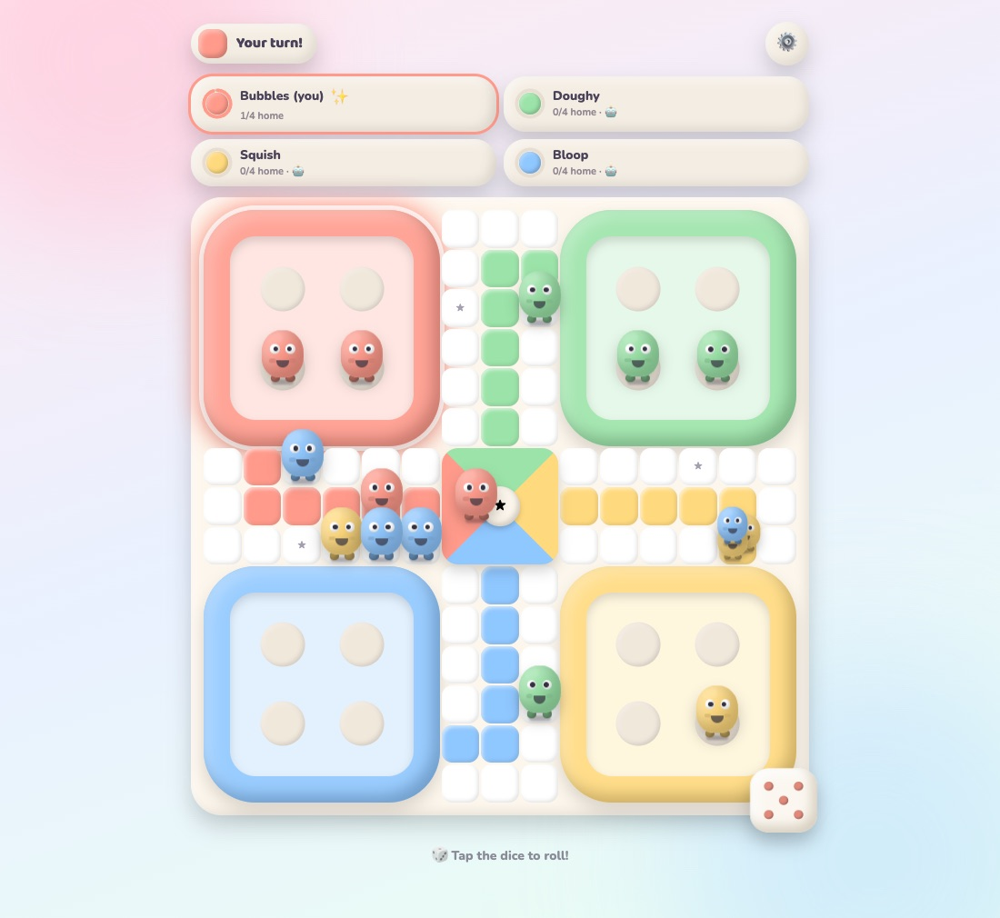
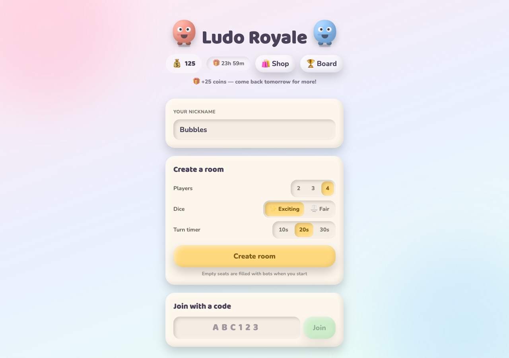
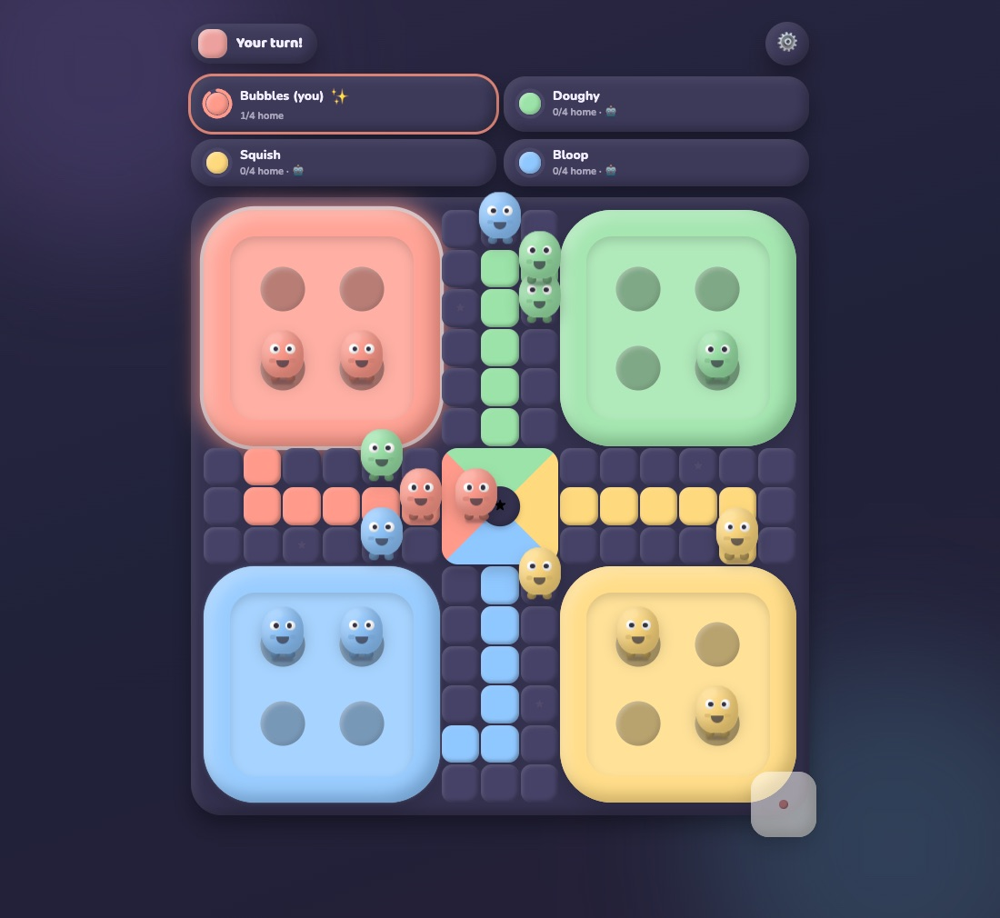

# Ludo Royale

Online multiplayer Ludo with squishy clay characters. Create a room, send the six-letter code to
friends, and any empty seats are filled with bots when the host starts.



| Home                                      | Dark theme                                            |
| ----------------------------------------- | ----------------------------------------------------- |
|  |  |

## What's in it

- Private rooms for 2 to 4 players, joined by code. Bots fill empty seats and take over for anyone
  who leaves mid-game.
- The server owns the rules. Clients only send "roll" and "move"; dice use `crypto.randomInt`.
- A turn timer that plays your best move if you go idle, and a two-minute window to reconnect to
  your seat after a refresh or a dropped connection.
- Two dice modes. Fair is plain uniform. Exciting gives players stuck in base or far behind a
  slightly better shot at a six, clamped so P(6) never leaves 12–33%.
- Coins: wager on a match, claim a daily bonus, spend them in the cosmetics shop, and climb the
  leaderboard.
- Clay characters or flat 2D tokens, light and dark themes, synthesized sound effects.

## Stack

A pnpm monorepo on Node 26 and TypeScript 7.

| Package           | What it does                                                         |
| ----------------- | -------------------------------------------------------------------- |
| `apps/client`     | React 19 + Vite 8 + Tailwind 4 SPA, state in Zustand                 |
| `apps/realtime`   | Colyseus 0.18 game server: rooms, turns, timers, bots, reconnects    |
| `apps/api`        | Express 5 REST API for the wallet, shop and leaderboard              |
| `packages/engine` | Rules, move scorer, bot and dice. Pure TS, used by server and client |
| `packages/shared` | Message types, plus the betting and daily bonus math                 |
| `packages/db`     | Postgres queries and plain SQL migrations                            |

## Running locally

You need Node 26 and pnpm 12. Node 26 no longer ships corepack, so install pnpm with
`npm i -g pnpm`.

```bash
pnpm install
cp .env.example .env            # point DATABASE_URL at any Postgres, or leave it empty
pnpm --filter @ludo/db migrate  # skip this if you have no database
pnpm dev
```

Open http://localhost:5173. The realtime server listens on :2567 and the API on :8080.

The game works without a database. You just won't have coins, the shop or the leaderboard.

## Scripts

```bash
pnpm test           # unit tests, plus full bot matches against a real server (~2.5 min)
pnpm typecheck
pnpm lint           # oxlint
pnpm format:check   # prettier
pnpm build
```

The realtime server reads a few env vars that help when working on animations: `LUDO_FAST=1`
speeds up bots, `FIXED_ROLLS=6,6,3` scripts the dice, and `ALLOW_DUP_DEVICE=1` lets the same
browser join a room twice.

## More

- [Game rules and board encoding](docs/GAME_RULES.md)
- [Architecture](docs/ARCHITECTURE.md)
- [Realtime protocol](docs/PROTOCOL.md)
- [Database](docs/DB.md)
- [Deploying](docs/DEPLOY.md)
